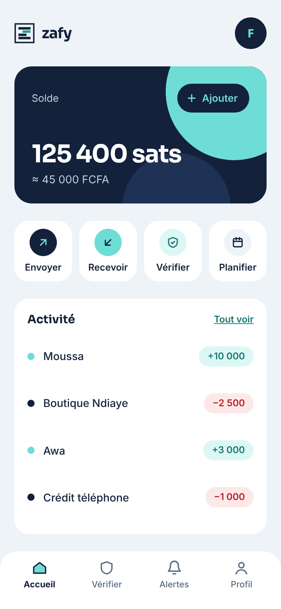
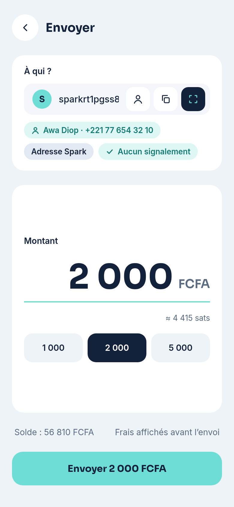
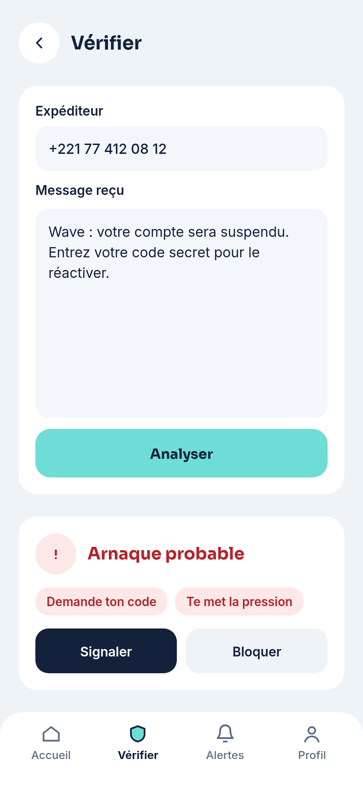
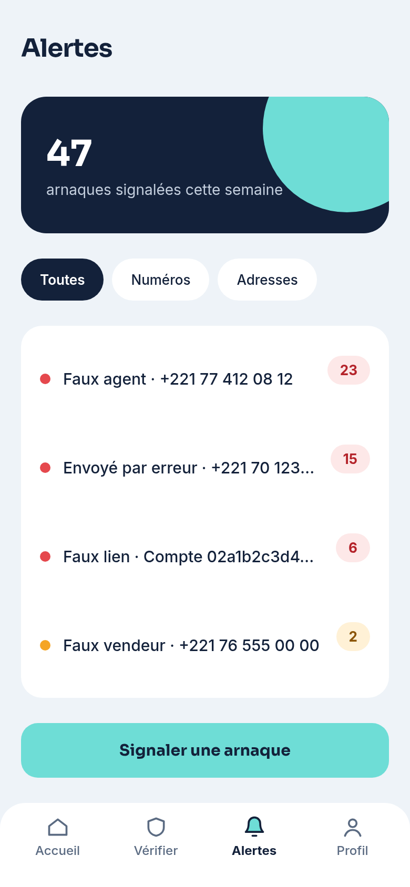
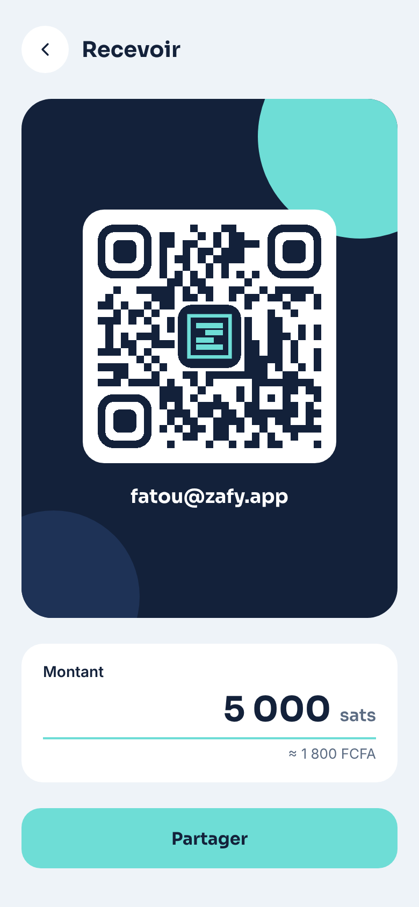
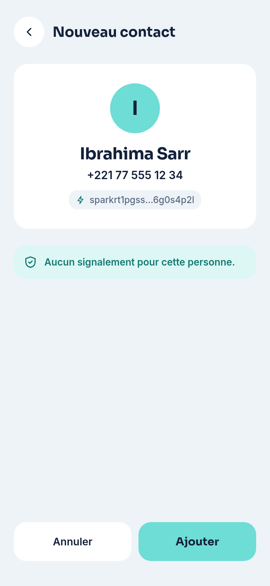
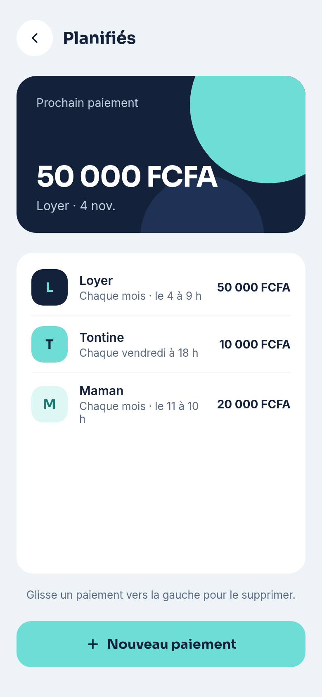
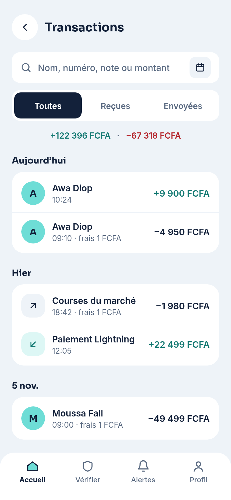
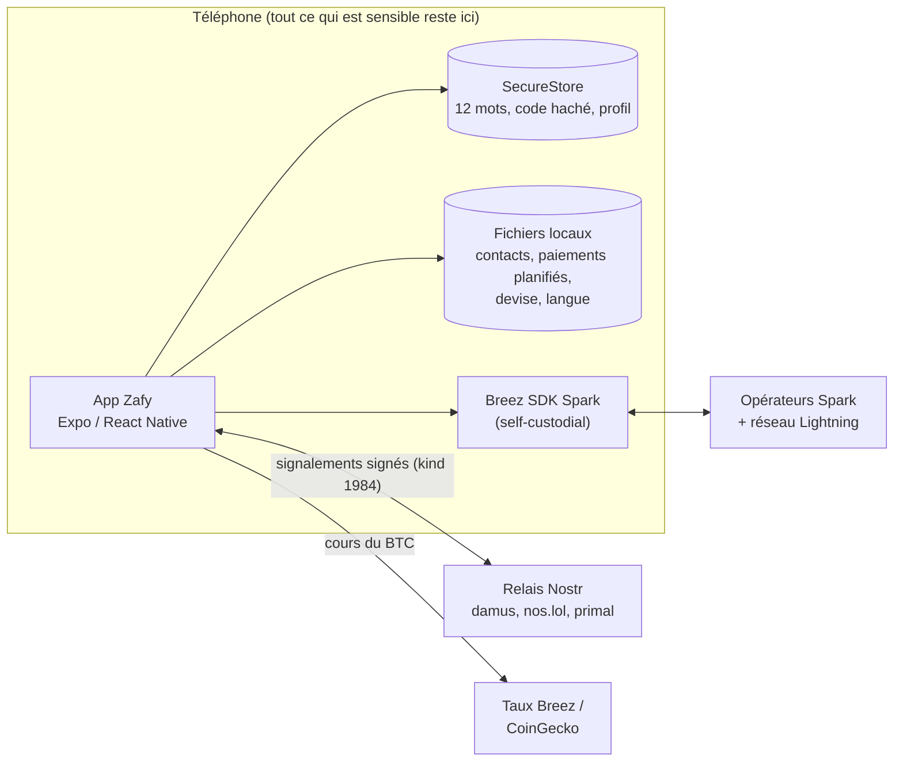

# Zafy — Zap + Safe

**Un wallet Bitcoin Lightning self-custodial qui protège les Sénégalais contre les arnaques au mobile money.**

Faux agents Wave ou Orange Money, codes USSD piégés, messages « je t'ai envoyé de l'argent par erreur », vol de carte SIM : au Sénégal, une SIM volée ou un code donné à la mauvaise personne suffit souvent pour perdre son argent. Zafy garde les clés sur le téléphone, prévient avant de payer un escroc signalé et montre exactement à qui on envoie l'argent.

<table>
  <tr>
    <td align="center"><br /><sub>Accueil</sub></td>
    <td align="center"><br /><sub>Envoyer : contact + vérification</sub></td>
    <td align="center"><br /><sub>Vérifier un message</sub></td>
    <td align="center"><br /><sub>Alertes de la communauté (Nostr)</sub></td>
  </tr>
  <tr>
    <td align="center"><br /><sub>Recevoir (facture Zafy)</sub></td>
    <td align="center"><br /><sub>Ajouter un contact par QR</sub></td>
    <td align="center"><br /><sub>Paiements planifiés</sub></td>
    <td align="center"><br /><sub>Historique</sub></td>
  </tr>
</table>

Les 26 écrans sont dans [`zafy-maquette/ecrans/`](zafy-maquette/ecrans), et le guide de design dans [`zafy-maquette/DESIGN.md`](zafy-maquette/DESIGN.md).

---

## 1. Problème et utilisateurs

**Utilisateur principal :** un petit commerçant ou une famille au Sénégal qui envoie et reçoit de l'argent chaque jour (loyer, tontine, aide à la famille, paiements des clients) et qui est régulièrement visé par des arnaques au mobile money.

**Ce qui change au quotidien**

| Aujourd'hui (mobile money) | Avec Zafy |
|---|---|
| Le compte est lié à la carte SIM : une SIM volée peut vouloir dire de l'argent volé. | Les clés sont créées et gardées sur le téléphone. Une SIM volée ne donne accès à rien. |
| Un faux agent demande ton code secret par téléphone ou par SMS. | Zafy ne demande jamais de code par téléphone. L'écran **Vérifier** repère les messages d'arnaque typiques. |
| Tu paies un numéro sans savoir s'il a été signalé. | Avant chaque paiement, Zafy affiche **« Signalé par N personnes »** ou **« Aucun signalement »**, grâce aux signalements de la communauté sur Nostr. |
| Tu recopies un long numéro en espérant ne pas te tromper. | Scanne une fois la **carte Zafy** d'un contact : son nom et son numéro s'affichent ensuite à chaque paiement, facture et ligne de l'historique. |
| Le loyer et la tontine dépendent de ta mémoire. | **Paiements planifiés** avec un rappel à l'heure choisie, ou un envoi automatique. Les montants peuvent être fixés en FCFA. |

**Portée (objectif de pilote, pas encore mesuré) :** un marché de Dakar, environ 50 commerçants, qui reçoivent chacun environ 20 paiements par semaine, soit environ 1 000 paiements par semaine vérifiés par les signalements de la communauté. La [section 8](#8-métriques-à-suivre) liste ce que nous mesurerons.

---

## 2. Ce qui fonctionne aujourd'hui

| Fonction | État |
|---|---|
| Créer un wallet (12 mots BIP39), le déverrouiller avec un code à 4 chiffres ou l'empreinte, le restaurer avec les 12 mots | ✅ Réel (Breez SDK Spark) |
| Envoyer vers une adresse Spark, une facture Zafy, une facture Lightning ou une adresse Bitcoin, avec les frais affichés avant de confirmer | ✅ Réel |
| Recevoir avec un QR code : facture Zafy (Spark, qui contient l'identité de celui qui reçoit) ou facture Lightning pour les autres wallets | ✅ Réel |
| Sats de test gratuits (robinet Regtest) | ✅ Réel |
| Signaler un escroc (numéro, compte Spark ou nœud Lightning) et voir les alertes de la communauté | ✅ Réel (Nostr, kind 1984, relais publics) |
| Avertissement avant de payer un destinataire signalé ; bandeau si ton propre compte a été signalé | ✅ Réel |
| Contacts ajoutés en scannant une carte Zafy ; noms des contacts affichés dans Envoyer, l'historique et les alertes | ✅ Réel (gardés sur le téléphone) |
| Paiements planifiés avec rappels, envoi automatique facultatif, montants fixés en FCFA | ✅ Réel (notifications locales) |
| Historique avec recherche, filtres, détails et suppression locale | ✅ Réel |
| Affichage et saisie en FCFA, euro, dollar ou sats, avec les taux en direct | ✅ Réel (taux Breez, CoinGecko en secours) |
| Français et anglais | ✅ Réel (i18next) |
| **Vérifier un message** (détection d'arnaque) | ⚠️ Règles simples par mots-clés pour l'instant ; le modèle d'IA est la prochaine étape |
| Acheter des sats avec Wave ou Orange Money | ⏳ Affiché « Bientôt » |

---

## 3. Démo (3 minutes)

1. **Le problème (30 s) :** un faux agent Wave demande à Fatou son code secret.
2. **Vérifier (30 s) :** Fatou colle le message dans **Vérifier** et obtient « Arnaque probable : demande ton code, te met la pression ». Elle signale le numéro en un appui.
3. **Protection au moment de payer (45 s) :** dans **Envoyer**, le numéro signalé affiche un badge rouge « Signalé par N personnes ». Un contact connu (Awa) affiche son nom, son numéro et « Aucun signalement ».
4. **Un vrai paiement (45 s) :** Fatou scanne la facture Zafy d'Awa. Le montant est bloqué par la facture, les frais sont affichés et le paiement passe sur le réseau Bitcoin de test. Awa reçoit la notification « Paiement reçu ».
5. **Impact et suite (30 s) :** les clés restent sur le téléphone, la communauté protège tout le monde, et la suite, c'est l'IA de vérification, le réseau réel et l'achat via mobile money.

**Parcours à tester :** créer un compte → **Ajouter → Sats de test** (robinet) → sur un deuxième téléphone, **Profil → Ma carte** → la scanner depuis **Mes contacts** → **Envoyer** à ce contact → voir le paiement dans l'**historique** des deux téléphones.

---

## 4. Installation

Le dépôt contient trois dossiers :

```
zafy/
├── zafy_mobile/     App Expo (React Native, TypeScript, expo-router)
├── zafy_web/        Page de présentation (React, Vite, TypeScript)
└── zafy-maquette/   Écrans et guide de design
```

### App mobile

Breez SDK contient du code natif : l'app a besoin d'un **development build** (Expo Go ne suffit pas).

```bash
cd zafy_mobile
npm install
npx eas-cli@latest build --profile development --platform android   # une fois : installe le development build
npx expo start                                                       # puis ouvrir l'app sur le téléphone
```

Un APK autonome qui fonctionne sans ordinateur :

```bash
npx eas-cli@latest build --profile preview --platform android
```

Vérifications : `npx tsc --noEmit`, `npx expo lint`, `npx expo-doctor`.

L'app fonctionne sur le **réseau Bitcoin de test (Regtest)** : aucune clé d'API n'est nécessaire et aucun argent réel n'est en jeu. Les sats de test gratuits viennent du robinet Lightspark (bouton dans **Ajouter → Sats de test**).

### Page de présentation

```bash
cd zafy_web
npm install
npm run dev      # http://localhost:5173
```

---

## 5. Architecture



- **Pas de serveur Zafy.** Il n'y a ni backend ni base de comptes : les clés, les contacts et les réglages ne quittent jamais le téléphone.
- **Wallet :** Breez SDK Spark dérive le wallet des 12 mots et garde ses données dans l'espace privé de l'app.
- **Signalements :** événements Nostr signés avec une clé dérivée des 12 mots (NIP-06). Celui qui signale n'est donc identifié ni par son nom ni par son numéro.
- **Factures Zafy :** les factures Spark contiennent l'identité de celui qui reçoit. L'app du payeur peut ainsi la relier à un contact enregistré de façon cryptographique, et non à partir d'un texte libre.

---

## 6. Sécurité dès la conception

**Modèle de menaces**

| Menace | Parade |
|---|---|
| Vol ou duplication de la carte SIM | L'argent n'est pas lié à la SIM : les clés sont sur l'appareil, protégées par un code ou l'empreinte. |
| Manipulation (« donne-moi ton code ») | Le code ne quitte jamais le téléphone et personne d'autre n'en a besoin. L'écran **Vérifier** et l'écran des 12 mots préviennent qu'un « agent » qui les demande est un escroc. |
| Payer un escroc connu | Destinataire vérifié dans les signalements de la communauté avant chaque paiement. |
| Usurper un contact dans une facture | Les contacts sont reconnus par l'**identité Spark contenue dans la facture**, jamais par le texte de la facture. |
| Faux signalements ou spam | Les signalements sont signés. Une personne ne compte qu'une fois par cible. Le compteur est un avertissement, il ne bloque rien. |
| Téléphone volé | App verrouillée par un code à 4 chiffres (stocké sous forme d'empreinte SHA-256 salée) ou l'empreinte digitale. Les 12 mots ne s'affichent qu'après le code ou l'empreinte. |
| Téléphone perdu | Le wallet se récupère entièrement avec les 12 mots sur un nouveau téléphone. |
| Double paiement (automatique + manuel) | Un paiement est réservé pendant l'envoi et relu juste avant d'être envoyé. |

**Réglages sûrs par défaut**
- **Secrets :** les 12 mots et l'empreinte du code sont dans `expo-secure-store` (Android Keystore / iOS Keychain). Le code n'est jamais stocké en clair.
- **Permissions minimales :** la caméra n'est demandée que pour scanner les QR codes (pas de micro), la biométrie seulement pour déverrouiller, les notifications seulement pour les paiements.
- **Saisies validées :** chaque destination est analysée par Breez SDK avant l'envoi. Les factures bloquent le montant. Les numéros et les montants sont normalisés. Les 12 mots sont vérifiés avec la liste de mots BIP39.
- **Aucune donnée personnelle dans les journaux :** l'app n'écrit aucun journal (`console.*` n'est pas utilisé). Les noms et numéros des contacts restent sur le téléphone, et un numéro n'est publié que lorsqu'un utilisateur le signale comme arnaque.
- **Bibliothèques éprouvées :** Breez SDK Spark, `@scure/bip39`, `nostr-tools` (NIP-06 et signatures), modules Expo pour le stockage sécurisé, la biométrie, la caméra et les notifications.

---

## 7. Limites (liste honnête)

- **Réseau de test uniquement (Regtest)** pour le hackathon. Le réseau réel demande une clé d'API Breez.
- **Vérifier un message** utilise des règles par mots-clés pour l'instant, pas un modèle d'IA.
- **Les notifications de paiement reçu** fonctionnent quand l'app est ouverte ou récemment en arrière-plan. Les notifications push, app fermée, demandent un petit serveur qui écoute les webhooks Breez.
- **Les adresses Lightning simples** (`nom@zafy.app`) ne sont pas disponibles sur Regtest.
- **Les contacts et les paiements planifiés ne sont gardés que sur le téléphone.** Ils sont perdus avec le téléphone tant que la sauvegarde chiffrée sur Nostr n'existe pas.
- **Les signalements Nostr sont publics et permanents**, et n'importe qui peut en publier. C'est pourquoi le compteur est un avertissement, pas un verdict.
- **L'achat de sats via mobile money** n'est pas encore développé.

---

## 8. Métriques à suivre

| Métrique | Pourquoi |
|---|---|
| Paiements vérifiés dans les signalements par semaine | Usage de la protection principale |
| Paiements annulés après un avertissement « Signalé » | Arnaques évitées |
| Signalements publiés par semaine, et nombre de personnes qui signalent | Santé de la communauté |
| Part des paiements vers un contact enregistré | Confiance et moins d'erreurs de destinataire |
| Comptes qui ont confirmé avoir noté leurs 12 mots | Capacité à récupérer son wallet |
| Wallets actifs par semaine, fidélité à 4 semaines | Adoption |
| Temps entre l'ouverture d'Envoyer et le paiement confirmé | Rapidité de l'UX |

Ces mesures se feraient uniquement avec des compteurs agrégés qui respectent la vie privée : aucun numéro, nom ou adresse.

---

## 9. Prochaine version

1. **Détection d'arnaque par IA** pour l'écran **Vérifier** (un LLM qui renvoie un verdict, un score et des raisons), avec les règles par mots-clés en secours hors connexion.
2. **Sauvegarde chiffrée** des contacts et des paiements planifiés sur Nostr (NIP-44, chiffrée avec la propre clé de l'utilisateur).
3. **Réseau réel (mainnet)** avec une clé d'API Breez, et les adresses Lightning simples.
4. **Notifications push** pour les paiements reçus (webhooks Breez).
5. **Achat via mobile money** (Wave, Orange Money) auprès de vendeurs vérifiés.
6. **Traduction en wolof**, relue par des locuteurs natifs.
7. **Lien de téléchargement** de l'APK sur la page de présentation, puis le Play Store.
